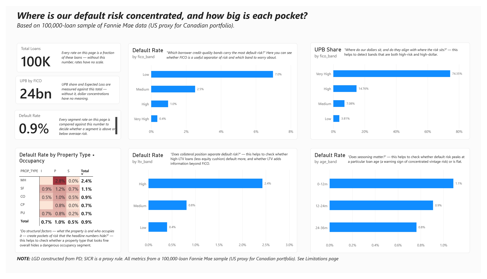
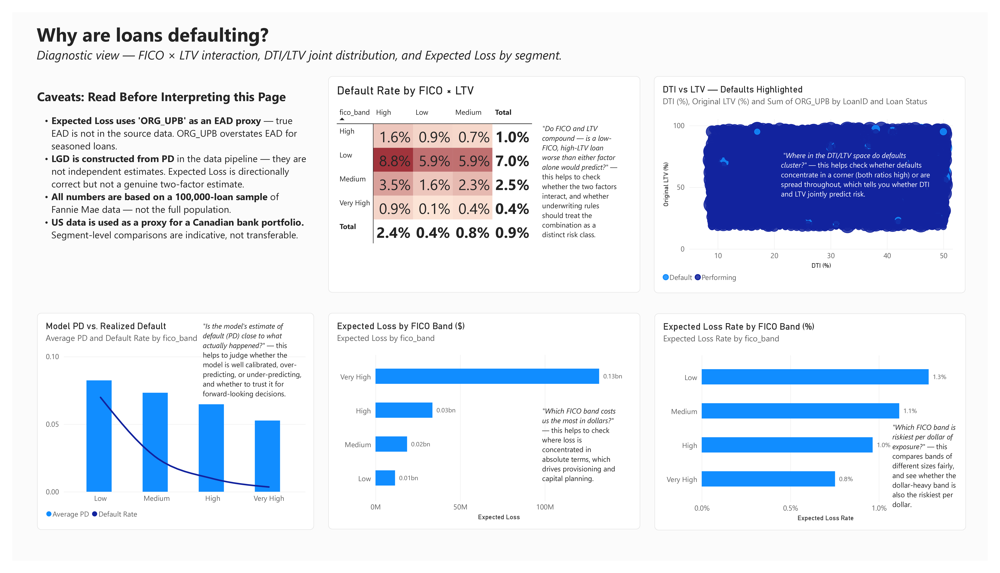
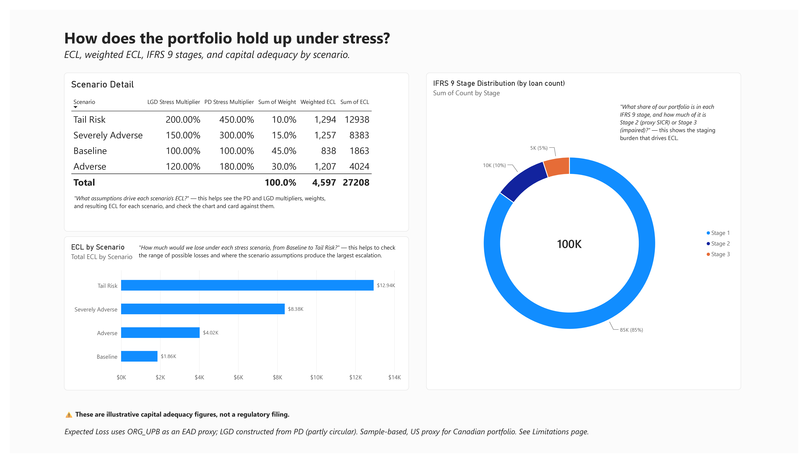
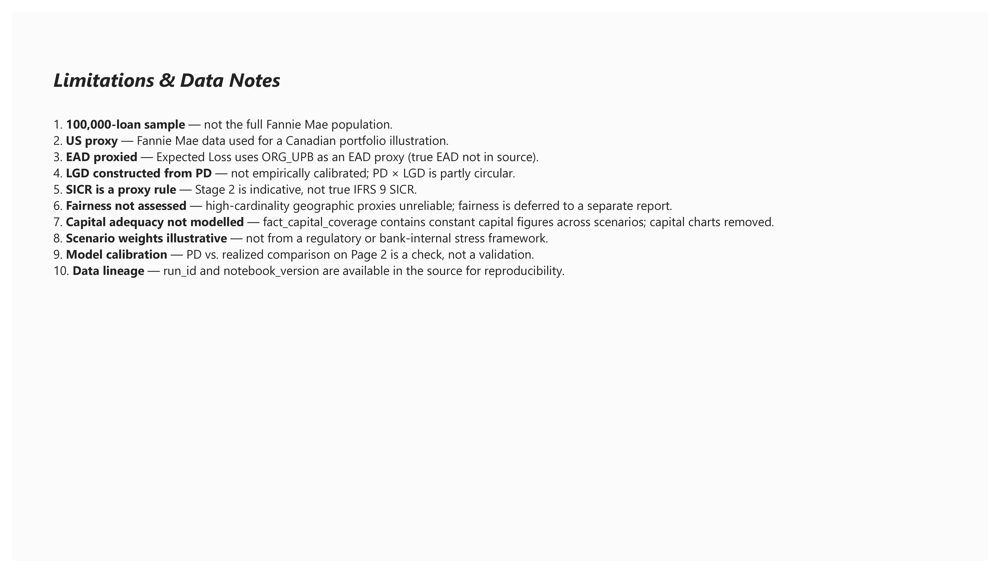

# IFRS 9 Stress Testing Dashboard — Fannie Mae

A three-page Power BI dashboard built to answer a credit-risk manager's questions about
default concentration, drivers, and IFRS 9 stress behaviour — using a 100,000-loan
Fannie Mae sample as a proxy for a Canadian bank portfolio.

> **Note:** All metrics are indicative. The dataset is a random sample, the portfolio
> is US-based (used as a proxy), EAD is proxied, and LGD is constructed from PD.
> See [Limitations](governance/limitations.md) before interpreting any number.

---

## The Business Problem

A credit-risk manager needs to answer three questions before a risk committee meeting:

1. **Where is our default risk concentrated, and how big is each pocket?**
2. **Why are defaults happening in those pockets?**
3. **How does the portfolio hold up under stress and IFRS 9 staging?**

The dashboard exists to answer these three questions — not to show every metric
the data could produce. Every visual on every page maps to one of the questions
in the [Question Map](https://github.com/MiltonGreat/Stress-Testing-Dashboard-/blob/main/governance/question-map.md). If a visual didn't answer a question,
it wasn't built.

---

## What the Dashboard Delivers

### Page 1 — Concentration
**Question:** Where is default risk concentrated, and how big is each pocket?

**What the risk manager sees:**
- Three KPI cards establishing the baseline (loan count, UPB, overall default rate)
- Four bar charts showing default concentration by FICO, LTV, and loan age; and
  dollar concentration by FICO band
- A property-type × occupancy matrix exposing structural pockets of risk

**What the reader is meant to conclude:** where the portfolio's risk sits, and
whether that risk is concentrated in count, in dollars, or both.

### Page 2 — Drivers
**Question:** Why are defaults happening in those pockets?

**What the risk manager sees:**
- A DTI/LTV scatter with defaults highlighted — where defaults cluster
- A FICO × LTV heatmap testing whether the two risk factors compound
- Expected Loss charts in dollars and as a rate
- A model PD vs. realized default chart — is the model calibrated?

**What the reader is meant to conclude:** which factors interact, where losses
concentrate, and whether the model's PD estimate can be trusted.

### Page 3 — Stress & IFRS 9
**Question:** How does the portfolio hold up under stress and staging?

**What the risk manager sees:**
- ECL by scenario (Baseline → Tail Risk)
- Weighted ECL as the planning number
- A scenario detail table (PD/LGD multipliers, weights, ECL)
- IFRS 9 stage distribution

**What the reader is meant to conclude:** the range of possible losses, the
probability-weighted planning number, and the staging burden driving ECL.

**Not built (deliberately):** capital adequacy charts — the `fact_capital_coverage`
table contains constant capital figures across scenarios, so no meaningful
scenario comparison is possible. Documented in [Limitations](governance/limitations.md).

---

## Screenshots

| Page | Preview |
|---|---|
| Page 1 — Concentration |  |
| Page 2 — Drivers |  |
| Page 3 — Stress & IFRS 9 |  |
| Limitations |  |

*(Screenshots taken from Power BI Desktop. Some formatting differs from the
published Service version — see [Data Preparation](docs/methodology/data-preparation.md).)*

---

## Approach

### Data
Source: Fannie Mae single-family loan performance sample (100,000 loans).
Loaded into Power BI Desktop, modelled as a star schema with `fact_loan_portfolio`
as the central fact table and `dim_scenario`, `dim_stage`, `dim_segment`, `dim_date`
as dimensions.

**Derived columns** (`fico_band`, `ltv_band`, `age_band`, `default_flag`) were built
by the source pipeline — see [Data Preparation](docs/methodology/data-preparation.md).

### Model
Star-schema relationship diagram and grain definitions:
[Model Relationships](docs/methodology/model-relationships.md).

### Measures
Every DAX measure with its purpose and filter-context behaviour:
[DAX Measures](docs/methodology/dax-measures.md).

Key measures include:
- `Default Rate` — portfolio default rate, used on every page
- `UPB Share` — dollar concentration relative to total UPB
- `Expected Loss` — SUMX over PD × LGD × ORG_UPB (EAD proxy)
- `Expected Loss Rate` — Expected Loss as a percentage of UPB
- `Weighted ECL` — probability-weighted scenario ECL
- `Average PD` — mean `pd_estimate` per segment, for calibration comparison

---

## Governance

This dashboard is built to be defensible, not just visual. The following documents
record what the numbers mean, what they assume, and what they don't cover:

- **[Limitations](governance/limitations.md)** — the full list of constraints,
  expanded from the Limitations tab in the report
- **[Assumptions](governance/assumptions.md)** — every assumption made (EAD proxy,
  US-as-Canada proxy, scenario weights, etc.)
- **[Data Dictionary](governance/data-dictionary.md)** — glossary of tables and columns
- **[Question Map](questions/question-map.md)** — every question the dashboard answers,
  mapped to the visual that answers it

These documents are not appendices — they are part of the project's argument.
A dashboard without them is a chart; a dashboard with them is a decision tool.

---

## Limitations (Summary)

Full list in [governance/limitations.md](governance/limitations.md). Key constraints:

- 100,000-loan sample, not the full Fannie Mae population
- US data used as a proxy for a Canadian bank portfolio
- Expected Loss uses `ORG_UPB` as an EAD proxy (true EAD not in source)
- LGD is constructed from PD — not empirically calibrated, and partly circular
- SICR uses a proxy rule, not true IFRS 9 SICR
- Capital adequacy not modelled — capital figures are constant across scenarios
- Fairness testing on high-cardinality geographic proxies is unreliable — not shown

---

## How to Use This Repository

- **To see the dashboard:** open the screenshots above, or download the `.pbix`
  from `/pbix` and open in Power BI Desktop.
- **To understand the analysis:** read the three page descriptions above, then
  the [Question Map](questions/question-map.md) for the full logic.
- **To audit the numbers:** start with [Assumptions](governance/assumptions.md),
  then [DAX Measures](docs/methodology/dax-measures.md).

---

## Tools

- **Power BI Desktop** — report authoring
- **DAX** — measures and calculated columns
- **Power Query** — data loading and light transformation
- **Git / GitHub** — version control and portfolio presentation

---

## About

This project was built as a portfolio piece to demonstrate:
- End-to-end Power BI development (data model → measures → visuals → governance)
- Business-question-driven dashboard design (every visual answers a specific question)
- DAX competence (`CALCULATE`, `SUMX`, `DIVIDE`, filter-context reasoning)
- Governance discipline (limitations, assumptions, and data dictionary documented)

**[LinkedIn]** · **[Portfolio]** · **[Contact]**
